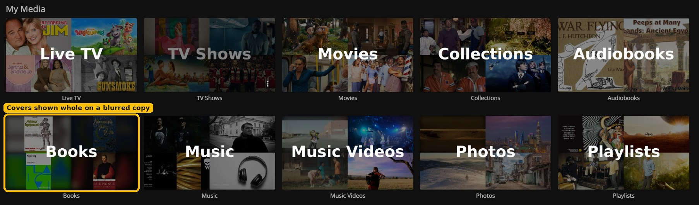
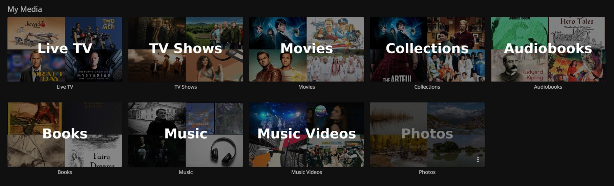

# Title Cards for Jellyfin


A Jellyfin plugin that turns every home-screen library image into a collage of that library's
own artwork, with the library name drawn exactly the way Jellyfin draws it. Every library gets
one, including Live TV (for which Jellyfin doesn't automatically generate an image), recordings, grouped
views and libraries added later. Images containing logos and lettering in the artwork that would obscure the library title are excluded.

**Status:** 0.1, an early release for Jellyfin 12.2. It runs on one server so far, so
[feedback and issues](https://github.com/erstenor/jellyfin-plugin-title-cards/issues) are very
welcome.

## Screenshots

Cards for Live TV, shows, movies, collections, recordings (DVR) and a grouped "TV Shows" view:


What Jellyfin shows by default (top) and Title Cards (bottom). Jellyfin generates a single-backdrop
image for most libraries and none for Live TV, which gets a plain colored card with an icon. The
plugin's title uses the same font, size and position as Jellyfin's; logos in guide art stay in the
outer corners, clear of it:


Every library type on the test server: Live TV, TV shows, movies, collections, audiobooks, books,
music, music videos, photos and playlists. The Playlists card is built from what's in the
playlists (here music, music videos, movies and episodes) rather than Jellyfin's playlist mosaics.
With **Crop square and portrait art to fill its tile** off (the
default), covers whose shape is far from their tile's are shown whole on a blurred copy of
themselves, as in the Audiobooks and Books cards:



With the setting on, covers are cropped to fill their tiles (the artwork differs between the two
screenshots because each refresh picks a fresh random sample):



The number of tiles varies with the artwork. Book and audiobook covers usually print their title
and author at the top or bottom, right where the library name crosses a quarter tile, so the text
filter often rules them out of the four-tile layout and the plugin falls back to fewer tiles. In
the two-tile layout the library name crosses the middle of each cover instead, which is usually
artwork. A tile whose
shape is close to its cover's (within 1.25×, such as a square cover in a two-tile half) is always
cropped slightly, whatever the setting.

The audiobook, book, music and photo libraries on the test server hold openly licensed sample
media; more testing on servers with large libraries of those types is welcome.

## Install

Requires **Jellyfin 12.2**.

1. In Jellyfin, go to **Dashboard > Plugins > Repositories** (on some versions **Catalog >
   Settings**) and add a repository:
   - Name: `Title Cards`
   - URL: `https://raw.githubusercontent.com/erstenor/jellyfin-plugin-title-cards/main/manifest.json`
2. Open the **Catalog**, find **Title Cards** and install it.
3. Restart Jellyfin. On startup the plugin builds a card for every library; the log shows
   `Title Cards: ... card saved` for each, and `Title Cards: text detection ready` where the text
   filter is available.

**Manual install:** download `title-cards_<version>.zip` from
[Releases](https://github.com/erstenor/jellyfin-plugin-title-cards/releases), unzip it into a
folder named `Title Cards_<version>` in Jellyfin's `plugins` folder (Docker: `/config/data/plugins/`),
owned by the user Jellyfin runs as, and restart. Manually installed plugins show "An error
occurred while getting the plugin details from the repository" in the dashboard until the
repository above is added; the plugin works either way. A manually installed copy may also have
automatic updates turned off, so *Update Plugins* skips it. Once the repository is added, install
the latest version from the Catalog (and restart) to switch to a normal, auto-updating install.

New versions can take a few minutes to appear in the Catalog after a release, while GitHub's
cache of the repository file refreshes.

**Uninstall:** remove the plugin from Dashboard > Plugins and restart. The cards stay as each
library's image until you replace them: delete a library's image under Edit Images and Jellyfin
generates its own again on the next library scan.

## What it does

For each view any enabled user sees on the home screen (once each):

1. **Gathers artwork** from a random sample of the library's items. Backdrops and landscape
   images come first; square album art and portrait covers are shown whole on a blurred,
   darkened copy of themselves, or cropped to fill the tile if you turn on **Crop square and
   portrait art to fill its tile**. Each library type has its own item types (series, movies,
   albums, photos, books...); unknown types use a broad default. Collections take one image per
   collection in turn, and a series only appears once. Playlists use the art behind what's in
   them (a track's artist backdrop and album cover, an episode's series, a movie's own art),
   one playlist at a time in turn, rather than the mosaic image Jellyfin makes for each playlist;
   a playlist with none of these falls back to its own image. Audiobooks stored as one file per
   chapter (which Jellyfin lists as one item per chapter) use their book folder's cover, so each
   book counts once, whichever chapter is sampled. No image is used twice on a card.
2. **Live TV** uses programs airing now (sports optional; their team-logo graphics clash with
   the title). Its artwork is each program's image from your guide data (the XMLTV `<icon>`
   element, or Schedules Direct's program images). Jellyfin doesn't look guide artwork up
   elsewhere, so if your EPG provider supplies no program images, or only portrait or text-heavy
   ones, there is nothing to build a Live TV card from and it keeps its current image. The log
   shows `Title Cards: Live TV: no images clear the title (0 candidates); image kept`. Libraries
   that contain a Live TV recording folder (e.g. DVR) use their recordings first, topped up from
   what's airing.
3. **Keeps text clear of the title**: an image is skipped for a tile if text is detected where
   the title covers that tile (with a 24px margin). Text elsewhere in the image is fine.
4. **Lays out** the largest arrangement it can fill: 4 tiles, else 3, 2 or 1. If nothing usable
   clears the title, the library keeps its current image.
5. **Draws** with Jellyfin's own recipe: black layer at alpha 0x78, the library name in the
   server's bold sans-serif at 112px, centered, baseline at half height plus half the x-height
   (see [Fonts](#fonts)).
6. **Saves** the card as the view's Primary image, the same way an image upload does.

### When cards are built

| Trigger | What runs |
|---|---|
| Nightly, 02:30 (Scheduled Tasks > Title Cards > *Refresh title cards*) | Every card, with fresh artwork |
| A user's home settings change, or a library is added | Missing cards only, about 20 seconds later |
| Server start, and every 30 minutes (*Create missing title cards*) | Missing cards only; a safety net |

"Missing" means a view the plugin hasn't handled, or one whose image is no longer the card it
saved (for example, the server regenerated its own). Changing **Home > Library Folders**
(grouped folders) gives that user a new combined view for the new combination of libraries, so
it gets a card shortly after. With nothing missing, these checks finish without loading the
text detector.

### Settings

Dashboard > Plugins > Title Cards:

- **Keep text out from behind the title** (on)
- **Leave sports out of Live TV cards** (on)
- **Crop square and portrait art to fill its tile** (off). Album, book and audiobook covers fill
  their tiles edge to edge like backdrops do, at the cost of their top and bottom: a square cover
  keeps the middle 56% of its height, a portrait book cover about 37%. Off, each cover is shown
  whole on a blurred copy of itself. Applies from the next refresh.
- **Build cards as soon as home settings or libraries change** (on)


Schedules are changed under Scheduled Tasks like any other task. After changing a setting, run
*Refresh title cards* to redraw existing cards straight away.

### Fonts

No font is bundled. The title uses whichever installed font the system's font configuration
picks for bold `sans-serif`, the same lookup Jellyfin uses for its own library images, so the
cards follow the server's fonts. In Jellyfin's Docker images that's DejaVu Sans Bold.

Characters that font doesn't have are drawn in another installed font that does, character by
character. For example, a Japanese library name such as `映画 Movies` keeps "Movies" in the title font and
draws 映画 in a Japanese font, if one is installed. Jellyfin's Docker images include no Japanese,
Chinese or Korean fonts, so those characters come out as boxes until one is added, and the log
names them:

```
Title Cards: 映画 Movies: no installed font has 映 画; they will show as boxes until a font with them is installed
```

Left: only DejaVu installed. Right: with Noto Sans CJK installed.


To add fonts in Docker, mount a folder of `.ttf`/`.otf`/`.ttc` files into the container's
`/usr/local/share/fonts/` (for example `- ./fonts:/usr/local/share/fonts/custom:ro` in Compose)
and restart Jellyfin. [Noto Sans CJK](https://github.com/notofonts/noto-cjk) covers Japanese,
Chinese and Korean. Fonts installed inside a running container are lost when it is recreated, so
mount them rather than installing them there. Outside Docker, install the font with your system's
package manager (for example `fonts-noto-cjk` on Debian and Ubuntu) and restart Jellyfin. Cards
made after the restart use it; run *Refresh title cards* to redraw existing cards right away.

## Platform support

| Platform | Cards | Text filter |
|---|---|---|
| Linux x64 (including Docker images such as linuxserver/jellyfin and jellyfin/jellyfin) | Yes | Yes |
| Linux ARM64 (Raspberry Pi 4/5, ARM NAS) | Yes | Yes |
| Windows, macOS, other Linux architectures | Yes | No, cards are built without it |

The text filter runs a small PP-OCR text detection model with ONNX Runtime, whose native
library is platform-specific. To keep the plugin at about 28 MB, only the Linux x64 and ARM64
runtimes are packaged. On other platforms the plugin logs a warning once and builds cards
without the check, so a logo can occasionally end up behind a title (mostly on Live TV, whose
guide art often carries show logos; library backdrops rarely have text).

**Windows and macOS in the future.** Supporting them is a packaging change rather than a code change:
the detector already uses whatever ONNX Runtime library it can load. Options:

1. **One package with every runtime.** Add `win-x64/onnxruntime.dll` (16.5 MB, about 6 MB
   compressed) and `osx-arm64/libonnxruntime.dylib` (42.8 MB, about 12 MB compressed), plus a
   loader entry for each in `TextDetector` like the Linux ones. One install for everyone, at
   about 46 MB. Simplest for users.
2. **Per-platform packages.** One zip per platform, each with only its runtime. Smallest
   downloads, but Jellyfin's repository manifest has one download per version, so each platform
   needs its own repository URL and users must pick the right one.
3. **Download on first use.** Ship without native runtimes and fetch the right one from the ONNX
   Runtime NuGet package when the filter first runs. Smallest install, but it needs internet
   access from the server and has more ways to fail.

If you run Jellyfin on Windows or macOS and would use the text filter, please say so in an
issue; it helps decide between these.

## Development

Needs the .NET 10 SDK; packaging also needs Python 3.

```sh
dotnet build Jellyfin.Plugin.TitleCards.sln
dotnet test Jellyfin.Plugin.TitleCards.sln
python build/package.py --version 0.1.0.0      # dist/title-cards_0.1.0.0.zip
```

Releasing: `python build/package.py --version X --changelog "..." --manifest` builds the zip and
adds the version to `manifest.json`; attach the zip to a GitHub release tagged `vX` and commit
the manifest.

Tests cover tile layout and selection, the renderer (including the per-character font fallback;
its Japanese test checks the drawing when a Japanese font is installed and the missing-character
report when not), and the detector's post-processing.
`DetectorParityTests` also compares the plugin's text detection with
[RapidOCR](https://github.com/RapidAI/RapidOCR) (detection and recognition) on real artwork, when
`TITLECARDS_FIXTURES` points at fixtures made by `build/make_parity_fixtures.py` from your own
server (the artwork isn't committed). On 65 Live TV and library images the plugin agreed on 58
and was stricter on 7: without RapidOCR's recognition step to drop weak matches, it errs toward
skipping an image. It never let through text that RapidOCR caught.

| Path | Contents |
|---|---|
| `src/Jellyfin.Plugin.TitleCards/Cards/` | Artwork selection, tile layout, rendering, text detection, saved-card state |
| `src/Jellyfin.Plugin.TitleCards/ScheduledTasks/` | *Refresh title cards* and *Create missing title cards* |
| `src/Jellyfin.Plugin.TitleCards/ChangeMonitor.cs` | Reacts to home-settings changes and new libraries |
| `tests/` | xUnit tests |
| `build/package.py` | Builds the zip and updates `manifest.json` |
| `build/make_parity_fixtures.py` | Makes fixtures for the detector parity test |
| `build/make_logo.py` | Draws the logo (abstract tiles, no third-party artwork) |
| `build/fetch_example_art.py` | Downloads openly licensed artwork for rendering example cards, with credits |
| `build/render_examples.py` | Renders example cards from that artwork, and Jellyfin's default no-image card (used in the before-and-after image) |

## AI assistance

This plugin was written with substantial help from AI. The code, tests, packaging scripts and
documentation were largely written by [Claude](https://www.anthropic.com/claude) (Anthropic),
working as a coding agent in Claude Code. The project's direction and design decisions, testing on
a live Jellyfin server, and review of the results were done by the maintainer
([@erstenor](https://github.com/erstenor)). Commits written with Claude carry a
`Co-Authored-By: Claude` trailer.

Please judge the code on its merits and report anything that looks wrong; issues and pull requests
are welcome whether or not you use AI tools yourself.

## Image credits

The audiobook, book, music and photo cards in the screenshots are built from public-domain and
openly licensed sample media: [LibriVox](https://librivox.org/) recordings and covers,
[Project Gutenberg](https://www.gutenberg.org/) ebooks, Internet Archive netlabel albums,
[Wikimedia Commons](https://commons.wikimedia.org/) photographs and
[Art Institute of Chicago](https://www.artic.edu/open-access) open-access artworks.

## License

[GPL-3.0](LICENSE), like the Jellyfin plugin template. Bundled third-party components (the text
detection model and ONNX Runtime) keep their own licenses; see
[THIRD-PARTY-NOTICES.md](THIRD-PARTY-NOTICES.md). Screenshots show artwork from a personal
library for illustration; it belongs to its respective owners.
