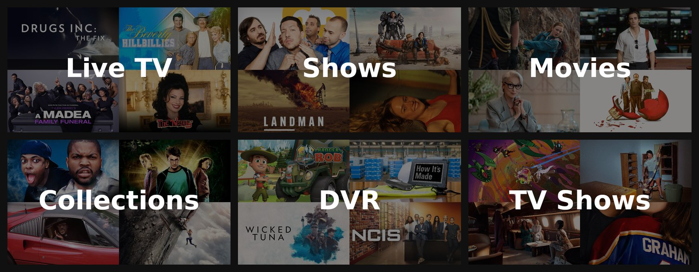
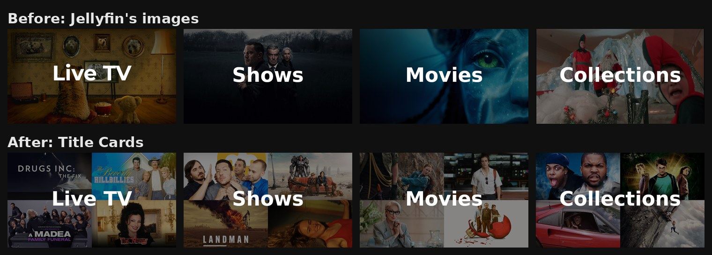
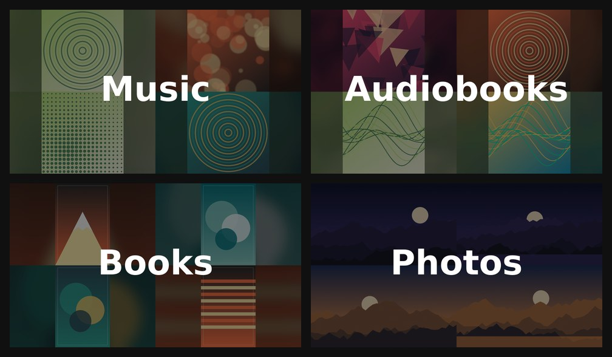
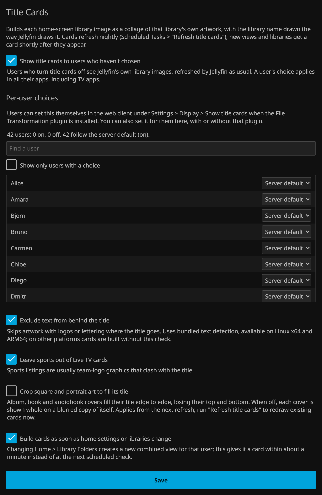

# Title Cards for Jellyfin


A Jellyfin plugin that turns every home-screen library image into a collage of that library's
own artwork, with the library name drawn exactly the way Jellyfin draws it. Every library gets
one, including Live TV (which Jellyfin doesn't generate an image for), recordings, grouped
views and libraries added later. Logos and lettering in the artwork are kept out from behind
the title.

**Status:** 0.1, an early release for Jellyfin 12.2. It runs on one server so far, so
[feedback and issues](https://github.com/erstenor/jellyfin-plugin-title-cards/issues) are very
welcome.

## Screenshots

Cards for Live TV, shows, movies, collections, recordings (DVR) and a grouped "TV Shows" view:



What Jellyfin shows by default (top) and Title Cards (bottom). Jellyfin generates a single-backdrop
image for most libraries and none for Live TV, which gets a plain coloured card with an icon. The
plugin's title uses the same font, size and position as Jellyfin's; logos in guide art stay in the
outer corners, clear of it:



This release runs on a single test server that only contains video libraries (i.e. movies, TV shows and Live TV). To test other library types, cards were rendered with the plugin's recipe from real, openly licensed artwork
(public-domain record labels, LibriVox and Standard Ebooks covers, NASA photographs; credits
below). Testing on live servers is welcome.



Books and Audiobooks came out with two tiles rather than four, which is the text filter at work:
most covers print their title in the middle or along the bottom, right where the library name
crosses a quarter tile, so the plugin uses a layout those covers can fill without lettering behind
the title. Covers with text clear of the title, such as the record labels above, fill all four.

## Install

Requires **Jellyfin 12.2**.

1. In Jellyfin, go to **Dashboard > Plugins > Repositories** (on some versions **Catalog >
   Settings**) and add a repository:
   - Name: `Title Cards`
   - URL: `https://raw.githubusercontent.com/erstenor/jellyfin-plugin-title-cards/main/manifest.json`
2. Open the **Catalog**, find **Title Cards** and install it.
3. Restart Jellyfin. On start-up the plugin builds a card for every library; the log shows
   `Title Cards: ... card saved` for each, and `Title Cards: text detection ready` where the text
   filter is available.

**Manual install:** download `title-cards_<version>.zip` from
[Releases](https://github.com/erstenor/jellyfin-plugin-title-cards/releases), unzip it into a
folder named `Title Cards_<version>` in Jellyfin's `plugins` folder (Docker: `/config/data/plugins/`),
owned by the user Jellyfin runs as, and restart. Manually installed plugins show "An error
occurred while getting the plugin details from the repository" in the dashboard until the
repository above is added; the plugin works either way.

**Uninstall:** remove the plugin from Dashboard > Plugins and restart. The cards stay as each
library's image until you replace them: delete a library's image under Edit Images and Jellyfin
generates its own again on the next library scan.

## What it does

For each view any enabled user sees on the home screen (once each):

1. **Gathers artwork** from a random sample of the library's items. Backdrops and landscape
   images come first; square album art and portrait covers are shown whole on a blurred,
   darkened copy of themselves. Each library type has its own item types (series, films,
   albums, photos, books...); unknown types use a broad default. Collections take one image per
   collection in turn, and a series only appears once.
2. **Live TV** uses programmes airing now (sports optional; their team-logo graphics clash with
   the title). Libraries that contain a Live TV recording folder (e.g. DVR) use their recordings
   first, topped up from what's airing.
3. **Keeps text clear of the title**: an image is skipped for a tile if text is detected where
   the title covers that tile (with a 24px margin). Text elsewhere in the image is fine.
4. **Lays out** the largest arrangement it can fill: 4 tiles, else 3, 2 or 1. If nothing usable
   clears the title, the library keeps its current image.
5. **Draws** with Jellyfin's own recipe: black layer at alpha 0x78, the library name in the
   server's bold sans-serif at 112px, centred, baseline at half height plus half the x-height.
6. **Saves** the card as the view's Primary image, the same way an image upload does.

### When cards are built

| Trigger | What runs |
|---|---|
| Nightly, 02:30 (Scheduled Tasks > Title Cards > *Refresh title cards*) | Every card, with fresh artwork |
| A user's home settings change, or a library is added | Missing cards only, about 20 seconds later |
| Server start, and every 30 minutes (*Create missing title cards*) | Missing cards only; a safety net |

"Missing" means a view the plugin hasn't handled, or one whose image is no longer the card it
saved (for example, the server regenerated its own). Changing **Home > Library Folders**
(grouped folders) gives that user a new combined view for the new combination of libraries, so
it gets a card shortly after. With nothing missing, these checks finish without loading the
text detector.

### Settings

Dashboard > Plugins > Title Cards:

- **Keep text out from behind the title** (on)
- **Leave sports out of Live TV cards** (on)
- **Build cards as soon as home settings or libraries change** (on)



Schedules are changed under Scheduled Tasks like any other task.

## Platform support

| Platform | Cards | Text filter |
|---|---|---|
| Linux x64 (including Docker images such as linuxserver/jellyfin and jellyfin/jellyfin) | Yes | Yes |
| Linux ARM64 (Raspberry Pi 4/5, ARM NAS) | Yes | Yes |
| Windows, macOS, other Linux architectures | Yes | No, cards are built without it |

The text filter runs a small PP-OCR text detection model with ONNX Runtime, whose native
library is platform-specific. To keep the plugin at about 28 MB, only the Linux x64 and ARM64
runtimes are packaged. On other platforms the plugin logs a warning once and builds cards
without the check, so a logo can occasionally end up behind a title (mostly on Live TV, whose
guide art often carries show logos; library backdrops rarely have text).

**Windows and macOS in future.** Supporting them is a packaging change rather than a code change:
the detector already uses whatever ONNX Runtime library it can load. Options:

1. **One package with every runtime.** Add `win-x64/onnxruntime.dll` (16.5 MB, about 6 MB
   compressed) and `osx-arm64/libonnxruntime.dylib` (42.8 MB, about 12 MB compressed), plus a
   loader entry for each in `TextDetector` like the Linux ones. One install for everyone, at
   about 46 MB. Simplest for users.
2. **Per-platform packages.** One zip per platform, each with only its runtime. Smallest
   downloads, but Jellyfin's repository manifest has one download per version, so each platform
   needs its own repository URL and users must pick the right one.
3. **Download on first use.** Ship without native runtimes and fetch the right one from the ONNX
   Runtime NuGet package when the filter first runs. Smallest install, but it needs internet
   access from the server and has more ways to fail.

If you run Jellyfin on Windows or macOS and would use the text filter, please say so in an
issue; it helps decide between these.

## Development

Needs the .NET 10 SDK; packaging also needs Python 3.

```sh
dotnet build Jellyfin.Plugin.TitleCards.sln
dotnet test Jellyfin.Plugin.TitleCards.sln
python build/package.py --version 0.1.0.0      # dist/title-cards_0.1.0.0.zip
```

Releasing: `python build/package.py --version X --changelog "..." --manifest` builds the zip and
adds the version to `manifest.json`; attach the zip to a GitHub release tagged `vX` and commit
the manifest.

Tests cover tile layout and selection, the renderer, and the detector's post-processing.
`DetectorParityTests` also compares the plugin's text detection with
[RapidOCR](https://github.com/RapidAI/RapidOCR) (detection and recognition) on real artwork, when
`TITLECARDS_FIXTURES` points at fixtures made by `build/make_parity_fixtures.py` from your own
server (the artwork isn't committed). On 65 Live TV and library images the plugin agreed on 58
and was stricter on 7: without RapidOCR's recognition step to drop weak matches, it errs towards
skipping an image. It never let through text that RapidOCR caught.

| Path | Contents |
|---|---|
| `src/Jellyfin.Plugin.TitleCards/Cards/` | Artwork selection, tile layout, rendering, text detection, saved-card state |
| `src/Jellyfin.Plugin.TitleCards/ScheduledTasks/` | *Refresh title cards* and *Create missing title cards* |
| `src/Jellyfin.Plugin.TitleCards/ChangeMonitor.cs` | Reacts to home-settings changes and new libraries |
| `tests/` | xUnit tests |
| `build/package.py` | Builds the zip and updates `manifest.json` |
| `build/make_parity_fixtures.py` | Makes fixtures for the detector parity test |
| `build/make_logo.py` | Draws the logo (abstract tiles, no third-party artwork) |
| `build/fetch_example_art.py` | Downloads openly licensed artwork for the example cards, with credits |
| `build/render_examples.py` | Renders the README's example cards and Jellyfin's default no-image card |

## AI assistance

This plugin was written with substantial help from AI. The code, tests, packaging scripts and
documentation were largely written by [Claude](https://www.anthropic.com/claude) (Anthropic),
working as a coding agent in Claude Code. The project's direction and design decisions, testing on
a live Jellyfin server, and review of the results were done by the maintainer
([@erstenor](https://github.com/erstenor)). Commits written with Claude carry a
`Co-Authored-By: Claude` trailer.

Please judge the code on its merits and report anything that looks wrong; issues and pull requests
are welcome whether or not you use AI tools yourself.

## Image credits

The example cards above use these public-domain and CC0 images:

- **Music:** [The Sounds of Earth (Voyager Golden Record cover)](https://commons.wikimedia.org/wiki/File:The_Sounds_of_Earth_-_GPN-2000-001976.jpg), NASA;
  record labels [Salam-e Shah (1910)](https://commons.wikimedia.org/wiki/File:Label_of_salam-e_shah_1910.jpg),
  [Dutch Daly, Wedding March and Carnival](https://commons.wikimedia.org/wiki/File:DutchDalyGandTlabel.jpg) and
  [Ostrich Walk, Okeh 40822](https://commons.wikimedia.org/wiki/File:Ostrich_Walk_Tram_Bix_Okeh_40822.jpg), via Wikimedia Commons
- **Audiobooks:** LibriVox covers for [The Crown of Life](https://librivox.org/the-crown-of-life-by-george-gissing/) and
  [The Roosevelt-Rondon Scientific Expedition and the Telegraph Line Commission](https://librivox.org/the-roosevelt-rondon-scientific-expedition-and-the-telegraph-line-commission-by-candido-mariano-da-silva-rondon/)
- **Books:** Standard Ebooks covers for [Oberland](https://standardebooks.org/ebooks/dorothy-m-richardson/oberland) and
  [On the Making of Man](https://standardebooks.org/ebooks/gregory-of-nyssa/on-the-making-of-man/william-moore_henry-austin-wilson)
  (cover designs CC0, paintings public domain)
- **Photos:** NASA, [iss066e146457](https://images.nasa.gov/details/iss066e146457),
  [iss039e009160](https://images.nasa.gov/details/iss039e009160),
  [Folded Rocks of Northwest Iran](https://images.nasa.gov/details/iss069-e-089946_lrg),
  [iss052e004998](https://images.nasa.gov/details/iss052e004998)

`build/fetch_example_art.py` downloads the full candidate set with a credit for each image, and
`build/render_examples.py --sources` renders the cards from it.

## License

[GPL-3.0](LICENSE), like the Jellyfin plugin template. Bundled third-party components (the text
detection model and ONNX Runtime) keep their own licenses; see
[THIRD-PARTY-NOTICES.md](THIRD-PARTY-NOTICES.md). Screenshots show artwork from a personal
library for illustration; it belongs to its respective owners.
